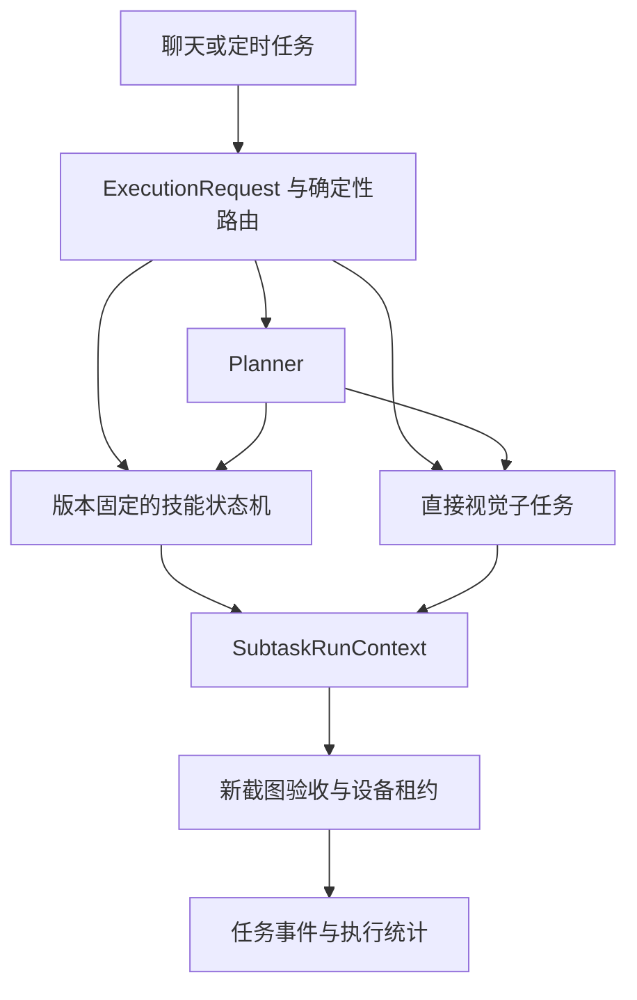

# AutoAgent-GUI 运行架构

## AutoMobile 界面与 USB 设备发现

网页侧栏、欢迎页和浏览器标题使用 AutoMobile，导航 Logo 与网页图标采用同一套
手机触控图形。Python 包、CLI、模型名称和历史数据路径保持兼容。

USB 设备由运行后端的电脑通过 ADB 自动发现，经 `/api/devices` 进入共享的
`DeviceProvider`，可见页面每 3 秒刷新。侧栏提供“刷新设备”按钮，立即重新读取
设备列表；它复用现有轮询缓存，不重启 ADB 或变更手机配置。“添加设备”说明 USB
自动识别流程，“无线连接”仍只扫描 mDNS 无线设备并支持 IP/端口与模拟器连接。

设备列表属于当前页面连接的后端实例。使用 `ADB_SERVER_SOCKET` 隔离 ADB 的测试
实例不能用于 USB 真机连接；排障时应核对浏览器端口与该实例的 `/api/devices`，
不能把另一端口的设备列表当成当前页面已识别设备的证据。正常使用应打开连接真实
ADB 的本地服务；保留验收实例的隔离设置，避免测试意外访问真机。

本次界面变更无数据迁移；回滚前端构建即可恢复原名称、图标和连接说明。

## RMQ1 iPhone 连接

新增 `connection_type=rmq1`、`platform=ios`，在设备列表中与 USB、WiFi、
HTTP Remote 并存。`DeviceManager` 只在登录、手机配置、HID 和首张画面检查通过后
注册连接；ADB 轮询不移除 RMQ1，列表状态来自视频新鲜度。删除连接及服务停止时
关闭视频线程并清除内存凭据。RMQ1 页面沿用设备列表、AI 对话区、手机画面的布局。未配置独立 iPhone 视觉模型时只提供预览与手动控制；配置后挂载现有 layered 任务界面和 RMQ1 画面面板。异步设备分派创建专用 `Rmq1AIAdapter`，同步 Android、旧 ADB 控制和 scrcpy 入口继续拒绝 RMQ1。

浏览器通过 `/api/rmq1/{probe,connect,disconnect,reconnect,observe,gesture,recover}` 与后端交互。
另外通过 `/api/rmq1/preview?device_id=…` 接收持续画面，通过
`/api/rmq1/control?device_id=…` 发送实时手动输入；两个 WebSocket 独立，输入不会暂停预览。
连接握手先校验 USB 与鼠标配置，再建立持久控制通道；首次 HID 状态可短暂离线，
最多等待 5 秒确认在线后才启动视频和注册设备。此等待只用于启动，操作与心跳仍严格
校验在线、模式及连接状态。控制会话初始化会由固件释放 HID，不发送试探点击或移动，
也不清除历史未确认标记。
`observe` 附带同一帧几何对应的 `content_rect`（归一化采集画面坐标，包含
`x/y/width/height`）。前端默认裁去黑边，缩放完整原图后在此区域内显示；手动
操作仍提交原始采集画面的归一化坐标，后端继续校验帧、会话、几何与黑边。
旧服务未返回有效区域时显示完整画面；显示设置可切换完整画面和调整栏宽。
缩放窗口或切换显示设置会取消手势并释放按键。窄内容区改为上下排列并可滚动。
iPhone 执行器使用独立动作集合和纯视觉界面身份，不伪造包名或 Android 导航键。
`RMQ1Transport` 只访问私有 IPv4 的 443 端口，在每次 TLS 连接发送密码或 cookie
前核对叶证书 SHA-256，不跟随重定向。状态查询串行复用已校验的 HTTPS 连接；
服务端关闭连接后重新建立时仍重新校验指纹，请求失败不自动重放。密码、cookie 不持久化。
`RMQ1Device` 先建立持续的 `/api/ws` 会话启动按需推流，再从 `/api/media/ws`
接收 H.264，使用 PyAV 解码，预览使用 JPEG 最新帧推送（最多 20 帧/秒），
旧 `observe` 按需编码 PNG。浏览器完成显示后回传 frame ACK，后端登记可操作帧并返回
`ready` 后，前端才允许用该帧开始输入，避免预览与控制两条连接之间的到达顺序竞争。
随后发送当时最新的画面，
中间帧不排队，不将慢客户端的积压传回设备视频通道。手势复用同一控制通道，
空闲心跳与手势通过互斥锁串行读取状态和确认消息；
前端仅活动页面接收画面，拖动过程中继续显示新帧，输入仍绑定开始时已显示的帧与几何。

实时输入协议为 `down/move/up/cancel`：`down` 携带 session/frame/action ID 与原始
采集画面归一化坐标，移动合并为最新点，松开携带最终位置。单手势最多 1500 毫秒，
快速点击保留至少 50 毫秒按压。失焦、隐藏、卸载、尺寸变化、取消与断流都结束原手势，
不自动重连重放。输入结果区分 `completed/rejected/unknown`；只有结果未知需要人工恢复。
鼠标滚轮/触控板的 deltaMode 统一后转换为短拖动，最多一个在途手势与有界残余量，
避免连续滚动变成无界操作队列。iPhone 不发送原生 wheel HID。
快速反向或切换滚动轴时，先取消原方向的短拖动，再等待释放确认与新帧执行最新方向；
取消失败进入未知结果隔离，不继续滚动。错误提示保留到手势结束再清除，避免按下瞬间
移除提示导致画面区域重排、继而触发尺寸变化保护并取消刚开始的输入。
验证或准备阶段、尚未写入任何 HID 时的取消返回 `completed/cancelled` 与
`receipt_scope=no_input`，并缓存原操作 ID；重复 DOWN 不得把已取消的操作变为真实输入。
该结果仅说明取消完成，不表示手机收到过点击。

手势绑定 session/frame/action ID，串行执行，在发送前校验 3 秒时效、尺寸、
方向和 HID 绝对定位输出（`usb`、`usb_hybrid`）。连接绑定首次确认的输出模式，
中途切换即停止输入。混合模式的绝对定位与按钮走不同 USB 端点，定位后至少等待
80 毫秒，并重新核对画面时效、尺寸、几何和 HID 状态后才按下；失败保留待确认标记。
坐标剔除黑边后按手机方向映射到 HID；释放后等待
原控制通道 pong，回执范围仅为 `kvm_transport`。操作 ID 去重与结果保留在
会话内，写入前持久化 0600 待确认标记以跨重启阻止未知动作重放。恢复必须由
使用者核对手机并显式确认；不自动重连或切换输入通道。RMQ1 REST、实时人工手势和 AI 共用 `PhoneAgentManager` 的任务租约，并由 RMQ1 自身操作锁串行写入。空闲预览/控制 WebSocket 不占输入权；任务持有租约期间人工输入被拒绝。
持续预览区分正在执行时的待确认标记与历史未知结果；正常释放或成功取消不会误报为需要恢复。

来电等中断后的手动 `reconnect` 先取得与 AI/其他手动输入共享的控制权，再在设备连接锁与非阻塞操作锁内执行；请求取消不提前释放后台重连持有的控制权，后台成功或失败后才释放。有在途输入或
未确认标记时拒绝复位；空闲时先停止旧控制/视频通道，再请求 RMQ1 复位 HID，使用
原本仅在内存中的认证和固定证书重建通道并等待首帧。混合模式的在线状态不能证明
按钮端点已恢复，因此显式复位涵盖两个输入端点。
成功后替换同一设备注册中的会话实例，生成新 session/frame ID；旧帧和旧手势不能
继续执行。缓存的 AI 适配器按设备 ID 读取当前实例，不沿用已停止的旧通道；重连前的
AI 观察仍因会话变化而拒绝执行，适配器自身未知状态不会因实例变化被清除。
失败不自动重试，保留认证供下一次显式连接；认证过期仍需断开并重新登录。
浏览器仅在后端完成后重开两个 WebSocket，并保留后端错误原因。画面中断时和显示
设置中提供「复位输入并重新连接」，按钮在输入忙或结果未知时禁用。

配置、使用限制、故障恢复及物理验收要求见 [RMQ1 iPhone 接入](rmq1-iphone.md)。

### RMQ1 iPhone AI 执行

可选 `iphone_vision` 配置组保存 `base_url/model_name/api_key/temperature`，不回退到 Android 模型或密钥。旧客户端省略字段会保留原值；显式 `null` 关闭 iPhone AI。配置更新仍受设备占用门禁约束。配置日志只记录键名，不记录配置值。`POST /api/config/iphone-vision-check` 只发送生成的红蓝测试图片，分别检查图片+工具调用和无动作 JSON 回答；成功不等于真机操作通过。设置页的测试使用未保存草稿，保存后才改变执行配置。

微信群导航路径开放 `ios_wechat_open_group(group_name)`，从已解锁主屏幕打开微信，使用系统简体拼音全键盘操作搜索框，检查最终汉字、完整群聊分类中的唯一同名结果，进入后立即停止。技能新增 `platforms`，缺省为 Android；编译产物保留平台声明，后端执行时复核。RMQ1 的普通子任务、经典模式和未明确支持的技能均被拒绝；另支持下文的内置大众点评 v4 纯视觉技能；自然语言 auto 路由仅接受有限的“搜索并进入青城群”或带引号群名的等价格式，不把额外发送、删除指令转成授权。复杂表述可选择技能并填写群名。

`Rmq1VisionAgent` 复用任务状态、预算、历史、回放和独立完成验收，提供 tap/swipe/wait/takeover/finish；不提供直接输入、包名启动或系统导航键。模型提出动作后，另一次无动作视觉请求检查落点、页面、搜索焦点、键盘和群身份，再由固定阶段策略判定是否允许。群名必须精确匹配且类别为 group；未完整展示分类、重名、无结果或不支持的键盘转人工。输入仅允许系统搜索/微信搜索，聊天页禁止一切输入与滚动。搜索阶段须先通过现有只读子任务验收才能进入 enter 阶段；最终完成还要求本任务实际执行过经核对的群结果点击，且新的截图通过标题验收。未发送约束由动作策略和执行记录审计，不能从最终截图推断。视觉检查仍受模型准确率限制，不是形式化的业务身份保证。

AI 观察保存独立的裁剪图与 session/frame/geometry/content_rect，不依赖实时预览的有限帧表。模型坐标为裁剪图的 0–1000 坐标，后端映射回原始采集画面。执行前重新取帧，比对连接/几何和页面、目标邻域的像素变化；使用缩小、轻度模糊及差异面积阈值容忍编码噪声，固定状态栏区域不参与整页比较，目标邻域仍参与检查。通知遮挡、目标位移、键盘变化等会丢弃旧动作并重新观察；连续三次拒绝后转人工。它不是整张 PNG 字节相等判断。新帧仍须通过原有 3 秒/HID/几何校验，不能只刷新帧 ID。

AI 输入复用可取消 `LiveGesture`，原通道释放及 pong 后才结算。停止请求的回执不解除控制：前端等待任务终态，后端保留租约直到 drain，无法确认则隔离并保留 pending 标记。REST/实时控制重复操作可只读取得原回执，无需重新取得输入权，也不会重放未知结果。人工恢复在同一管理器锁内检查任务、在途写入、RMQ1 持久标记并清理对应隔离状态。默认任务预算 60 步/600 秒；搜索单段最多 20 步，可在原任务预算内按现有已验证进度规则续跑一次；输入纠错最多两轮。

本次自动化使用模拟设备和生成图像。尚未执行真实模型调用；按用户要求暂不执行 RMQ1/iPhone 的物理验收，不声明点击准确率、实际完成率或端到端延迟。回退前停止任务、等待释放并核对未知结果；关闭 iphone_vision 即恢复手动入口。旧配置与技能定义向后兼容，不迁移数据库。


后端是 `AutoGLM_GUI/` 中的 Python/FastAPI 服务，HTTP API 与 Socket.IO 由 `server.py` 合并为 ASGI 应用；React 前端在 `frontend/`，桌面打包在 `electron/`。AI Agent 通过设备适配器执行任务；手动控制与任务共用 `PhoneAgentManager` 的设备占用边界。

## 大众点评 v4：纯视觉条件化技能

统一 `Observation` 保留截图身份、会话/几何、动作代际和时间；v4 页面判断不调用
UIAutomator、页面节点、OCR 或 OmniParser。Android 和 RMQ1 iPhone 使用同一视觉数据结构和
`VisualDianpingController`，设备适配器仅负责截图与动作。可信内置 ID 加版本 4 才能启用
该执行器，自定义副本和其他任务不能通过参数切换到它。v1/v2/v3 资源与已有定时绑定保留。

```text
任务参数（城市、准确店名）→ 可信内置 v4 → 设备租约 + 任务局部执行器
  → 新 Observation（上一动作后 / 本轮决策共用）
  → 空白加载检查：白色/浅灰空正文只等待，不猜坐标；最多四次
  → 一次视觉请求：页面、可见城市/查询、焦点、商户状态、门店、下一目标
  → 程序条件：先确认城市，再输入完整中文；只提交一次；不进入详情
  → 动作前代际/忙碌/未知结果检查 + 必要的像素变化检查
  → 平台动作 → 下一轮 Observation
  → 可见结果满足条件 → 新截图 + 原平台模型独立验收全部五项条件 → 终态
```

`VisualPage` 使用严格、完整 JSON：重复字段、额外字段、字符串布尔值、越界坐标、
截断回复和不可辨认页面均停止。每次请求最多 800 输出 token、30 秒 HTTP 超时、35 秒
总超时，SDK 不自动重试；失败请求也计入 executor_calls。历史只保留最近四个动作，
空白检查忽略顶部查询栏和底部系统栏，覆盖点评浅灰加载背景；误判最多产生有界等待，
不会授权点击。截图中的文字不是指令。DeepSeek Flash 使用 `thinking=disabled`；UI-Venus-2 使用
`chat_template_kwargs.enable_thinking=false`，将预算用于页面条件和坐标 JSON。
本路径不采用 UI-Venus 的完整推理轨迹模式。程序确认城市后才允许搜索输入；输入后的全文必须精确匹配，
商户分类须选中且至少两个不同可见门店包含关键词。模型的完成提议只触发独立验收。
最终验收失败停止，不重复提交或重复验收。每段最多 20 步、最多续接两段，沿用同一
条件状态和设备租约，总计不超过 60 步/600 秒；v4 预算续接不调用中间验收模型，
普通技能原有进度验收规则保持不变。重复目标无进展、持续加载或画面持续变化均有停止上限。

Android 使用现有坐标点击和 ADB 中文输入，保留原有动作等待。观察从采集开始不超过
3 秒且代际一致时，直接作为动作前证据；推理更慢时再取一帧，比较几何、弹层变化、
顶部身份区域以及目标附近（输入时还比较搜索框/键盘），变化则丢弃提议并重新决策，
最多两次。模型决策本身最多保留 30 秒。该时间窗和像素检查不能保证页面在点击瞬间
不变，也不是语义安全证明；最终独立验收继续保留。回放事件引用 Observation ID，
不会为 pre_action/post_action 记录再截图。

RMQ1 的截图附带不可变 `FrameReference`（原始 session/geometry/frame/content_rect）。
同尺寸连接或几何变化也会使旧 Observation 失效。动作转换回原生帧对象，保留现有
租约复查、重新取帧、场景/目标比较、LiveGesture 绑定及未知结果隔离。iPhone 不使用
ADB、包名启动或系统返回键，只点可见返回/应用图标；中文输入限定已聚焦搜索框里的
可见拼音全键盘与候选词。不支持的键盘、图标/城市不可见或目标歧义时停止。此路径
已有模拟适配器测试，Android 实测不代表 iPhone 已完成物理验收。

可选 `skill_vision` 配置组（`base_url/model_name/api_key/temperature`）只覆盖 v4 视觉
执行模型；省略时使用原平台模型，最终独立验收始终使用原平台模型。
包装器和原托管执行器的连接均保留到整个任务收尾，确保技能后续普通子任务可复用原模型；
收尾去重关闭全部连接。iPhone 仍先要求
独立 `iphone_vision`，不会回退到 Android 凭据。`GET/POST /api/config` 支持新字段，
旧客户端省略时保留，显式 null 清除；任务中配置改变会使 checkpoint 失效。配置可通过
本机配置 API 或配置文件设置；本次不新增设置页。对照模型时固定验收模型、五项条件、
手机、起点与动作等待，只切换执行模型。实际模型调用量由执行指标统计，截图量按
底层采集 span 统计，不能用回放图片数量替代；失败样本保留并与成功耗时分开报告。

无数据库迁移。回退先停止任务并确认设备空闲，再新建任务固定使用 v2（视觉通用执行）
或 v3（Android 节点控制）。关闭 `skill_vision` 恢复原平台执行模型，不会修改验收配置。

## 应用布局与设备列表

应用不再显示全局横向底栏。语言、主题、构建版本、更新与版本不匹配提示集中在左侧导航的“界面设置”弹层，保留原有版本查询逻辑。设备分组列表采用名称/连接类型主行、序列号/操作次行；状态点附在设备图标上，移动分组入口不再占用额外侧列。长名称最多展示两行，并通过悬停显示完整名称。设备选择与重命名、移动分组、无线连接操作分别处理事件，操作按钮不会触发设备选择。手机面板自己的状态栏保持独立。

## 统一聊天入口与兼容边界

聊天页 `/chat` 默认使用任务路由入口 `execution.py`，在现有 `layered` 会话中选择技能、直接视觉执行或 Planner。三条路径共用 `subtasks.py` 的任务租约、结构化结果与新截图验收。Planner 会话仍由 SQLiteSession 管理，手机执行器按 task 隔离。高级设置中的经典模式仍由 `TaskManager._execute_classic_chat` 执行，保留图片输入及原有接管路径；它与第二版的已验证直接执行不同。

分层执行在视觉适配器自身的系统提示词后追加目标确认、坐标单位、误点即停止
和禁止盲目重放等约束。Gemini 保留 function calling 协议，GLM/Qwen 保留各自
动作格式；重置时重新读取当前提示词配置。分层子任务采用下面定义的动态步数预算，
同子任务续跑保留上下文，任务结束销毁局部执行器。预算包含模型的完成报告轮次。
`ELEMENT_NOT_FOUND`、`WRONG_TARGET`、`SCREEN_CHANGED` 等明确失败不能被普通
finish 报告或后续 Planner 文字改判成功。

独立的 MCP `chat` 保留每次 5 步、重置及恢复原配置的兼容行为，也追加保留原协议的
约束；它没有分层 `execute_subtask` 的 checkpoint 或独立完成验收。Planner 只暴露 `list_devices / list_skills / execute_skill / execute_subtask`；独立 MCP 接口不参与技能路由。

顶部不再提供双模式切换。设备栏「设置 → 高级设置 → 聊天执行方式」保留「自动规划（默认）」和「直接执行」，保存后应用，取消或关闭放弃未保存的选择。选择仅记录在当前聊天 URL；刷新沿用，新的无模式链接仍默认自动规划。路由以 URL 为模式来源，继续识别旧 `mode=classic` 和 `mode=chatkit`，不迁移或删除旧会话及历史。

Planner 路径需要视觉模型和决策模型；技能与已验证直接执行只需要视觉模型。缺少决策模型时仍展示技能和直接执行入口，直接执行必须填写明确完成条件。API Key 是否必需由所用服务决定。

视觉模型与决策模型页签均提供 `DeepSeek V4.1 Flash` 预设，填入官方 OpenAI 兼容地址 `https://api.deepseek.com` 与模型 ID `deepseek-flash`。视觉预设同时选择 `General Vision Agent`（`agent_type=gemini`）并清空其他 Agent 的专用参数，复用现有图片输入与 function calling 路径；切回智谱或 ModelScope 的 AutoGLM 视觉预设时恢复 `glm-async` 及其默认参数，避免沿用不匹配的工具调用协议。决策预设只修改决策地址和模型名称。两个 API Key 输入框由用户分别配置，预设不提供密钥。选择后仍需保存，取消或关闭会恢复原配置，不改变未选择预设的现有配置与默认值。官方接口与图片输入说明见 [API 文档](https://api-docs.deepseek.com/) 和 [Vision 指南](https://api-docs.deepseek.com/guides/vision/)。`deepseek-flash` 的视觉与规划请求均显式关闭 DeepSeek 思考模式：视觉端保持强制工具调用（思考模式不支持 `tool_choice=required`），规划端避免现有 Chat Completions 会话丢失 `reasoning_content` 导致多轮工具调用失败。其他模型沿用原有行为。本次不增加公共 API 或数据库迁移；回滚前端即可移除预设，已保存配置仍可作为自定义服务使用。真实 DeepSeek 调用与真机执行需在用户配置密钥后另行验证。

后端会话与 MCP 的 `mode` 仍使用既有 classic/layered 值；任务内的 `execution.route` 独立选择路径。定时任务已改为绑定技能 ID、版本、参数，不再使用 workflow 或 execution_mode。配置服务请求失败不会自动切换执行方式。

聊天入口的布局调整不改变手机控制协议。浏览器回归验证默认分层会话、保存/取消、刷新恢复、旧链接、缺少决策模型的提示与直接执行入口；原有直接执行任务、图片输入及接管恢复测试继续运行。回滚前端版本可恢复顶部切换，不需数据库迁移。上述测试不代表两个模式的真机成功率或性能对比。

## 已验证子任务与执行器范围

当前内置执行器只保留 GLM（`glm-async`，兼容 `async-glm`，原始 `glm` 配置自动规范化）、Qwen（`qwen`）和
General Vision（`gemini`，兼容 `general-vision`）。MAI、DroidRun、Midscene 的代码、专用参数 UI、依赖和打包入口移除。旧配置仍按原类型读取，`GET /api/config` 返回新增的 `agent_type_supported=false`，不会回退默认执行器；保存和初始化拒绝旧类型。用户改选受支持类型后清空旧 `agent_config_params`，历史中的旧类型标签与字符串结果仍能读取。配置保存和删除先在 manager 建立原子更新边界：已有任务、租约或人工操作时返回 409 且不写盘；更新期间拒绝新的设备获取。保存、环境同步及空闲执行器销毁完成后解除更新边界；删除保留原有语义，不额外同步环境或重建执行器。

`execute_subtask(device_id, goal, success_criteria, constraints, max_steps=10, checkpoint=None)`
按可验证的界面状态划分子目标，每段预算为 1–20 步，整个 task 的累计步数受请求预算和
`default_max_steps` 的较小值约束，Planner 轮数仍受 `layered_max_turns` 约束。返回七种状态：
`completed / partial / blocked / failed / cancelled / needs_user / unknown`。
兼容包保留 `result / steps / success`，result 增加目标、状态、停止原因、累计步数、验收摘要与续跑句柄；success 仅 completed 为真。进度事件区分 executing 与 verifying。

模型 `finish` 只申请完成。分层运行的 Gemini 执行器仅可在末尾文本输入动作 `type_text` 上设置 `verify_after=true`：仅当动作成功、没有待确认或未知结果时结束执行段，省去单独宣布完成的一轮模型调用。此路径在动作后额外等待可取消的 1 秒，为页面加载留出缓冲，并再次检查取消和未知结果；等待不证明页面就绪，验收仍为不可判定时停止，不自动重试。导航、点击和切换分类继续观察后使用 `finish`，因为真机试验发现模型会在仍有后续步骤时提前交接；经典模式不暴露此参数。已经完成且无需动作时也使用 `finish`。系统继续持有设备并取得新截图，复用执行器视觉模型进行只读、无动作工具的验收；逐项返回 `met / unmet / unknown` 及理由、可观察事实、时间和截图 SHA-256。
所有条件满足才能 completed；明确未满足返回 partial，验收不可用或不可判定则停止。
这张验收截图只在内存参与判断，不加入工具结果或历史，也不新增图片读取 API；
hash 不能用于回看图片。下述执行阶段的回放截图沿用原有 trace 采集策略，与这张独立验收截图分开处理。

验收请求保留 `max_tokens=4096` 上限，沿用提供方原有思考配置。真实正反例中，DeepSeek 关闭思考的验收会将错误选中标签判为满足条件，因此未将关闭思考作为默认优化。短条件 ID 响应也未稳定通过实测，因此继续要求模型逐字返回完整条件，沿用现有 API、历史和 UI 格式。复合条件须逐项满足，明确指定的标签选中状态、页面身份和输入全文不能由相似内容替代。严格检查完整条件集合、顺序、类型和重复 JSON 字段。同一任务懒创建并复用验收 API 客户端，取消、结束或模型配置失效时关闭；不跨任务缓存截图或验收结果。
总超时为 130 秒，模型请求超时为 120 秒，SDK `max_retries=0`。
字段解析允许完整 JSON 外层的 Markdown 代码块、单项条件对象、判断值的大小写及首尾空白，并忽略顶层和条件对象内的额外字段（例如误放到条件内的 `facts`）。顶层 `facts` 是可选辅助信息：字符串转为单项列表，缺失或无效时使用空列表，只保留前 20 条非空字符串。每项条件仍必须提供精确的 `criterion`；缺失或无法识别的判断、缺失或无效的截图理由均归为 `unknown`，不能产生完成结果。格式归一化不按位置补写条件、不猜测判断，不改变历史/API 的标准输出结构；回滚无需迁移数据，但旧版本会重新拒绝这些格式变体。
系统先检查响应是否完整，再解析 JSON 和核对条件。`finish_reason=length` 返回
`verification_output_truncated`，即使截断响应恰好能解析也不能通过；其他非 `stop`
结束原因、空响应、JSON/结构错误、条件不匹配、请求失败和超时均有独立错误分类，
返回 `blocked`。不因此自动重试验收或重放设备操作。

`subtask.verify` span 覆盖截图、模型调用、解析与条件匹配，模型调用仍为其子 span。
验收结果新增可选 `diagnostics`，只记录固定字段的诊断元数据：阶段、预算、结束原因、
token 用量、响应长度与 SHA-256、请求 ID 的 SHA-256、异常类型、脱敏校验路径和条件不匹配索引。
不保存原始响应、思维链、验收截图、密钥或服务方错误原文；旧记录没有该字段仍可读取。
字段随现有任务事件和历史保存，无数据库迁移。详见[追踪与可观测性](docs/explanation/observability.md)。

partial 仅用于本段预算耗尽或验收明确未满足，附当前 task 内的一次性 checkpoint。
续跑校验目标、条件、约束及设备一致，保留执行器上下文并注入验收差异；旧句柄消费后失效。
未完成子任务须先续跑，不能跳过后新建子任务。checkpoint 不跨用户轮次、task 或进程恢复；取消、结束、模型配置变化后不可复用。整体成功要求至少一个子任务，且所有已发起子任务的最新状态均 completed；其他终止状态不能被 Planner 最终文字覆盖。第二版任务入口在 Planner 正常结束后，额外对用户原始目标或明确传入的最终条件进行只读验收；未能从当前截图证明的要求保持未验证，不能由 Planner 自述补足。

当前 task 的 SDK run context 另保留按设备隔离、有界的近期执行摘要，用于后续子目标
了解已有操作。摘要包含目标、结果与动作几何，不复制图片、完整模型推理或输入文本
参数；同一子任务的续跑由原执行上下文及验收差异支持。摘要和旧坐标只作为历史数据，
执行器必须重新观察当前画面，不能自动重放。它们不跨 task 或后端重启恢复，
也不改变 Planner 会话的持久化方式。

设备租约在 task 首次使用设备时取得，贯穿执行、验收与 partial 等待；同物理设备的其他 Agent context 与人工输入不能写入。取消只命中所属 task，先停止新动作，等待在途本地 ADB / 远端操作结算后释放租约；无法确认则保留设备隔离，不重放未知动作。task 结束销毁局部执行器、清理 checkpoint，Planner 对话与历史继续保留。

分层内部执行回放继续写入 `logs/runs/<trace_id>/replay.jsonl` 的 `phone_agent`
事件，以独立 `call_id` 关联每段执行及其步骤 `index`；`event_seq` 在每段内编号。
Gemini 通用 function calling 适配器记录模型实际看到的 `observation`、模型选定
动作、`pre_action` 和 `post_action` 截图及执行结果，保存图像宽高。分层 Gemini 可将成功动作的回放后截图作为下一步观察：仅同一执行段、相邻步骤、单次使用且单调时钟年龄不超过 1 秒；取消、续跑、敏感截图、尺寸变化、失败和未知结果均不复用，trace 标明来源与年龄。真实动作前仍重新截图；无设备写入的 `finish` 不再获取动作前截图。
推理期间尺寸改变会停止而不点击。分层 Gemini 还比较观察与动作前截图的遮罩变化，明显新增的暗背景弹窗或加载中弹窗的显著内容变化会返回 `SCREEN_CHANGED` 并停止；此规则忽略状态栏和导航栏，不识别验证码文字，也不覆盖已经稳定显示的验证码或所有同尺寸 UI 变化。其他适配器记录流式步骤结果，不宣称已有同等截图覆盖。
后续截图失败不会重放已执行的操作；取消时保留已取得的证据。执行截图只证明采集
时的画面，操作返回成功也不等于目标通过验收；尺寸检查不排除同尺寸的 UI 变化。

回放复用 `AUTOGLM_TRACE_ENABLED`、`AUTOGLM_TRACE_REPLAY_ENABLED`、
`AUTOGLM_TRACE_CAPTURE_SCREENSHOT=artifact|off|on_error` 和
`AUTOGLM_TRACE_CAPTURE_ACTION`。默认 `artifact`；`on_error` 在该段未完成或取消时
保留其截图缓冲，最多 60 帧（20 步、每步最多 3 帧），超出时保留最新证据，
不会在结果确定前直接落盘；敏感截图不保存。文件名包含调用 ID，避免不同子任务或续跑段
互相覆盖；图片以 artifact 引用保存在回放文件，不把 base64 写入模型返回文本或
任务数据库。沿用历史删除/回放删除机制，旧回放事件格式保持兼容。回归使用模拟
设备，真实模型的目标定位准确率和执行效果仍需单独验收。

通用视觉执行器不提供任意 UI tree/OCR 路由或持久化动作账本；下文的大众点评 v3 只为限定页面接入本地节点读取。无需数据库结构迁移，状态与验收摘要随现有任务事件保存。升级/回滚须先停止任务并核对设备空闲，成套更新前后端；进程内 checkpoint 会失效。回滚到旧版本才能重新使用被移除的执行器，清空的旧参数需从升级前保存的配置恢复。确定性回归覆盖状态、验收、续跑、互斥与取消边界，真实成功率、误报率、token 与耗时改进仍需真机对照实验。

### 统一观察与动作代际

`AsyncDeviceAdapter` 为一次执行会话持有 `ObservationBroker`，初始观察、Gemini 过程截图和独立验收经统一入口取得不可变 `Observation`。它记录观察 ID、会话 ID、几何 ID、动作序号、代际、采集开始/结束的单调时间和采集目的；旧 `Screenshot` 接口保留，读取观察中的截图会取得防御性副本。当前提供者仍是设备截图，尚未将 Android scrcpy 编码流解码为后端共享像素帧。

同一代际内同时等待的普通请求可共享一次尚未完成的采集；请求默认不隐式复用已完成截图。显式近期缓存必须检查年龄和代际，`fresh=True` 则独立采集并切断此前共享请求的缓存传播。取消某个消费者不取消其他消费者仍需的采集；最后消费者退出后，迟到结果不能重新成为当前证据。窗口尺寸变化更新几何 ID，较旧采集不能把几何回退。

设备写入开始和完成分别建立观察边界，跨边界的在途采集失效；动作序号表示底层设备写入次数，不等于模型步数。写入未结算或结果未知时，不返回可授权下一动作的观察。执行段开始、reset、取消和显式恢复会清理或更换观察会话；旧会话不能授权新动作。原始截图读取仍可用于只读恢复，但不能据此清除未知结果。这里的代际跟踪程序发起的写入，不是对 App 所有异步刷新或外部输入的自动检测。

最终 `verify_completion` 对适配器调用 `get_observation("verification", fresh=True)`，取得最后动作结算后的独立新截图；旧设备接口仍直接重新截图。验收器只收到目标、原始完成条件和当前图像，不采用控制器状态或动作 ACK 作为成功证据。现有完整响应、逐项条件匹配、`unknown`/失败不成功的规则不变。[V2E6]

## Android 预览与手动控制

```text
Android scrcpy 3.3.3 视频 socket → Python 分包 → Socket.IO → WebCodecs → Canvas
Pointer Events → 前端有序队列 → control-input → ControlSession → scrcpy 控制 socket
```

`scrcpy_stream.py` 启动工程携带的 3.3.3 服务端。新控制会话使用随机 `scid` 和 ADB 动态转发端口，各自关闭自己的连接和进程，不清理其他 scrcpy 实例。视频、控制各用一个 socket；音频和剪贴板自动同步关闭。控制协议固定为 3.3.3，升级服务端时必须同时核对二进制布局和回归测试。当前支持一个触摸指针及原生滚轮，不提供多指手势。

默认标准档为最长边 1280、4 Mbps、20 FPS；流畅档为 1280、4 Mbps、30 FPS；低带宽档为 800、1 Mbps、15 FPS。档位保存在浏览器本地，改变档位会结束旧连接并重新建立视频会话。以上是编码上限，不能视为实测帧率或延迟。

## 输入顺序与坐标

`frontend/src/lib/phone-control.ts` 保持一个发送中的命令，并合并相邻未发送的 MOVE。DOWN、UP、CANCEL 不会因节流被丢弃，队列最多 32 项。坐标来自当前已渲染视频尺寸，限制到 `[0, width-1] × [0, height-1]`，由 scrcpy 将视频坐标映射到设备显示，不依赖首次截图尺寸。

后端每个控制会话使用独立 ID、单调序号和互斥锁；视频配置包使 epoch 增加。旧会话、乱序输入、旧 epoch 和越界坐标被拒绝。新尺寸完成渲染后取消旧手势；未获得新几何信息时不能假定释放成功。

Pointer capture 保证拖出画面仍收到松开。失焦、pointercancel、捕获丢失及页面隐藏请求取消。触摸期间断线时，后端先写入 scrcpy CANCEL，再通过设备原生 `input motionevent CANCEL` 等待取消处理，最后关闭投屏进程并释放设备所有权，避免取消数据尚未注入就终止服务器。原生取消最多等待 5 秒；失败、超时或旧 Android 不支持 CANCEL 时保留隔离，需检查手机后显式恢复。命令完成不等同于业务成功，真机测试仍用受控应用的触摸计数核对。触摸期间浏览器每 750ms 发心跳，后端超过 2.5 秒无活动尝试取消。写入超时 1.5 秒，浏览器控制 ACK 超时 3 秒。失败不会自动重放 DOWN、MOVE 或 UP。

## 所有权、失败与人工恢复

手势期间持有设备所有权；AI 的任何 context 为 BUSY 时拒绝人工输入，人工手势期间拒绝 AI 获取设备。人工操作前应先停止正在执行的 AI 任务。视频观看本身不占用 AI 执行权。

控制 ACK 的 `sent` 只代表数据写入控制 socket；scrcpy 没有逐触摸的 Android 注入确认，不能声称业务动作成功。界面取消原来的“已点击/已滑动”乐观提示。控制失败或无法确认释放时，后端保留设备隔离，重新连接不会自动解除。操作者检查手机已无未结束触摸后，使用“确认手机状态并恢复”明确解除。该隔离位于当前后端进程内，不是持久化执行账本；进程异常退出后必须人工检查手机状态再操作。

旧 `/api/control/*` 接口保留响应结构。tap/swipe 与新控制、AI 共用占用边界；HTTP 请求取消后仍等待底层 ADB 线程结束才释放占用，执行失败则保留隔离；HTTP DOWN/MOVE/UP 按设备串行并检查 ADB 退出码。HTTP touch 要求明确 device_id；没有 DOWN 的 MOVE 被拒绝，UP 可单独请求释放；HTTP 触摸闲置 15 秒尝试释放，失败保留隔离。旧 HTTP 客户端不支持流会话的 epoch 校验，浏览器使用新协议。

## 视频与可观测性

新客户端逐包 ACK：配置包在解码器接收配置后确认，数据包在帧渲染后确认。后端等待 ACK 再读下一包，3 秒未确认则关闭该流，限制应用层和浏览器队列积压。设备编码器/ADB/TCP 内部仍可能缓存，不能把这个上限等同于端到端延迟上限。

界面显示当前使用视频还是截图，以及渲染 FPS、最近最多 100 个控制请求的往返 P95。P95 使用浏览器单调时钟；后端响应包含本地处理耗时 `server_ms`。它们都不代表手指到屏幕响应的端到端测量。画面超过 3 秒未更新会提示，并限制新输入，避免盲点操作。

手机面板采用页头、画面、页脚的纵向布局：页头常驻“显示设置”，展开后在画面上方调整模式、画质和面板宽度；页脚显示当前模式、渲染 FPS 和控制 P95。设置、状态和错误/恢复提示均参与布局，不叠加到视频或截图上。画面按原始比例完整缩放，设置展开和横屏时也不裁切。截图模式只显示“仅查看”，不保留视频的旧指标。播放器通过 `onPlaybackStats` 向面板报告状态与指标，此接口不改变视频和输入协议。

H.264 播放器通过 `connect-device.videoWindow=4` 协商最多 4 个未完成渲染的帧，让 USB 读取、解码与绘制并行，避免每帧都等待一次完整往返才读取下一帧。后端由单一生产者顺序发送二进制事件，按发送时刻限制每帧渲染确认的 3 秒期限；发现配置变化即推进输入 epoch，拒绝旧几何输入；等待旧帧全部完成后再传递新配置。前端使用带唯一时间戳的原生 H.264 解码器，将每个输出帧绑定到对应的几何与 ACK，实际绘制完成才确认；释放解码器后不确认迟到帧。窗口溢出或解码错误终止连接，不建立无界队列。旧前端、旧后端以及非 H.264 解码路径保留单帧确认兼容；输入顺序、所有权、未知结果隔离和取消机制不变。

自动模式在首次连接超时或不支持 WebCodecs 时回退截图；已建立连接出错后显示重连/恢复入口；截图模式每次请求结束后等待 750ms，自动回退等待 1200ms。截图请求在 15 秒后取消并展示超时错误；业务失败与 HTTP/网络错误也进入错误提示，不再停留在加载中。失败后继续按上述间隔轮询，设备恢复后自动显示新画面。切换设备、模式或页面不可见时取消在途请求，旧设备的画面与迟到响应不会显示到新设备。截图分支只读。视频必须具备 WebCodecs 支持和安全上下文。

## 验证与上线/回滚

单元和契约测试覆盖 scrcpy 二进制、手势顺序、释放、过期/错误会话、未知结果隔离、AI 互斥、旧 HTTP 行为以及启动/断线竞态。浏览器测试用合成 H.264 经真实 WebCodecs 解码，并验证拖出画面释放、失焦取消和队列不重放；它不证明真机注入已完成。

本地完整 E2E 验证可设置 `AUTOGLM_E2E_SCREENSHOTS_DIR=test-results/docs-screenshots`，将文档截图产物写入前端测试目录，避免覆盖已跟踪文档图片；未设置时保留原文档截图生成路径。

前后端应成套更新，旧后端缺少 session 元数据时新前端提示升级。回滚时先停止手动与 AI 操作、关闭预览、确认手机没有持续触摸，再整体回滚前后端。不得把超时后的原手势作为新动作重放。单进程后端是当前所有权和会话状态的运行前提；多进程/多主机部署需增加统一设备仲裁。

真机验收使用可控测试页面，检查连续拖动、长按、拖出窗口、失焦、旋转、断线恢复和 AI 冲突，并独立测量输入到画面响应的 P50/P95；代码测试与静态检查不能替代该验收。


## 第二版：技能、任务路由与评测

技能增加可选展示元数据 `app: {id, name} | null` 和 `icon`；`app=null` 或缺省表示通用技能。技能库按应用筛选与分组，聊天和定时任务共用带本地图标的分组选择器；平台、禁用状态和版本绑定仍沿原逻辑处理。自定义技能可编辑应用和功能图标，复制内置技能保留元数据。应用分类不授予设备操作权限；Planner 的 `list_skills` 返回应用归属，执行仍使用技能 ID、版本和参数。

Android 内置 `dianping_search_shops` v1 随包资源分发，以原本地 v6 的四阶段视觉导航与验收定义为基础，保留 40 步／600 秒预算及只到达商户列表的边界。旧本地 `dianping_city_shop_search` 保留独立 ID 和全部版本，读取时仅为缺失字段补充展示元数据，不改写磁盘或定时绑定。无元数据的其他旧技能归为通用；未知应用／图标使用默认图标。资源纳入 Python 包与 Electron 后端打包，图标随前端分发，无外部图标请求。

`dianping_search_shops` v2 将上述四个业务阶段写入一个连续导航步骤 `search_shops`。执行器只初始化一次，首页、城市和输入全文作为下一动作的前置观察要求，不再各自请求独立验收或输出阶段完成；输入属于中间动作，明确禁止 `type_text.verify_after=true`。这仍是视觉模型遵循的技能约束，不是新增 OCR 或确定性页面识别。实际进度显示一个连续步骤，不能将四个内部阶段显示成已独立验证。单段最多 20 步、不自动续跑；仍受技能总上限 40 步／600 秒和请求预算约束。最终 `finish` 后，原有验收器重新截图并逐项验证原结果页条件、技能最终条件和调用者附加条件；失败、未知或格式无效都不能成功，不重放搜索。

v2 连续执行复用已有的相邻动作后观察缓存（单次使用、1 秒有效期），减少阶段重启截图；动作前新截图、遮罩／尺寸检查、取消和未知操作结果检查不变。最终验收保留自行获取新图，不复用执行器的结论或陈旧截图。固定脚本的 11 次执行决策可形成 21 张执行截图和 1 张独立验收截图；这只是调用链回归基线，真实次数和耗时必须从手机任务 trace 统计。未接入 OmniParser 或 UI-Venus，也不缩短输入法及加载等待。

`dianping_search_shops` v3 增加限定场景的条件化控制器。只有编译结果保留可信 `builtin=true`、ID 精确为 `dianping_search_shops` 且版本为 3 时，`execute_skill` 才将经过参数校验的城市/关键词作为内部 `dianping_parameters` 交给 `SubtaskRunContext`。它在任务局部 Agent reset 后绑定 `DianpingController`，不修改全局模型设置，也不向 Planner 暴露任意控制器选择参数。执行器限 Gemini function calling 适配器，设备须具备本地 ADB UI hierarchy 能力；不支持时停止。新子任务 reset 会清除绑定，checkpoint 还核对控制器参数，避免其他技能沿用前一任务的控制器。[V2E1][V2E7]

```text
固定内置 v3 + 精确城市/关键词
  → execute_skill → SubtaskRunContext（租约、预算、局部 Agent）
  → 每步新 UI hierarchy + 新 Observation
  → DianpingController（页面与目标条件）
  → 动作前应用/年龄/代际/未知结果检查 → 既有 AsyncActionHandler
  → 下一步重新观察；满足结果条件时仅请求 finish
  → 独立 fresh 截图 + 原有验收模型 → 任务终态
```

控制器以本地节点的包名、页面标志、resource-id、准确文本、可见性、焦点和几何判断当前页面，只支持已定义的首页、城市选择、输入页和搜索结果页。每个动作都使用新的节点与截图；节点采集开始至动作前不得超过 5 秒，v3 截图从采集开始计不得超过 2 秒（包含采集耗时），二者必须属于同一观察会话和代际，动作前再次检查前台应用、取消和在途/未知写入。该 2 秒限制是拒绝过期证据的上限，不保证页面在窗口内不变；普通 Gemini 的相邻观察缓存仍为 1 秒。一次观察可同时作为上一步的动作后记录和本步的动作前证据，回放以观察 ID 引用图像，不为每个记录事件另截一张。这里复用的是同一步已取得的新证据，不是跨动作沿用旧坐标。[V2E7][V2E8]

需要切换城市时，目标城市必须在当前支持的历史访问或热门城市区段中可见并全文匹配；输入框必须可编辑且非密码框，历史词和占位文本不能替代输入全文。控制器核对关键词后只提交一次搜索；选中商户结果且至少两个不同门店与目标品牌、城市条件相符时才请求终验。返回首页最多三次，已发出的导航不盲目重放，尚未完成的已知跳转只允许每个等待点最多两次 0.5 秒等待。未知页面、歧义目标、覆盖窗口、城市不可见、输入不符、证据过期或结果未知均停止，不自动改走视觉模型猜测。控制器步骤不调用执行模型；最后仍调用既有独立验收模型，不能把规则通过当作整个任务完成。保留每段 20 步、不自动续跑及既有时间/总步数预算。

本地 UIAutomator dump 和 PNG 截图是先后读取，**不是原子快照**；同代际和 TTL 只能约束程序操作与时间，不能证明两次读取间没有同尺寸异步变化。节点也不保证覆盖 WebView、自绘内容或所有浮层。因此 v3 是针对已支持 App 页面结构的有限控制器，不是通用手机感知方案；遇到缺失或不一致证据即停止，最终独立新图验收仍保留。UI hierarchy 通过有界 ADB 调用读取，使用任务专属临时文件并清理，不将原始 XML 打印到日志。未接入 OmniParser、UI-Venus 或新的外部模型服务，未改变现有模型配置和固定输入等待。真实耗时还包括节点读取，是否更快须通过同设备、同起点且包含失败样本的真机对照确认。[V2E8]

内置目录保留 v1、v2 和 v3 的不可变资源，v3 发布时发现接口返回 v3；当前发现接口返回下文的 v4；固定 v1 的任务仍按四阶段执行，固定 v2 的任务仍走连续视觉执行，旧自定义技能及定时绑定不迁移。复制技能产生的自定义定义不启用内置控制器。无新用户配置字段和数据库迁移。v3 页面或设备不支持时，先停止任务、确认设备空闲，再用同一 ID 显式选择版本 2，开始新任务；不在失败任务中静默降级。回滚到不含 v3 的旧程序前，应将固定 v3 的定时任务停用或改绑，不得静默替换版本。

此更新不迁移数据库，需成套升级前后端并事先备份 `skills.json`。新后端兼容旧定义；新保存的展示字段不兼容旧后端严格 schema，回滚须停止任务、确认设备空闲，留存当前配置后恢复升级前技能备份。历史真机通过不能替代新环境的物理验收。

技能是版本化执行计划：参数 schema、只读前置条件、有序步骤、每步完成条件、作用类型、续跑次数、最终条件和总预算。定义存储在 `~/.config/autoglm/skills.json`，不执行 Python、shell 或坐标录制脚本。参数以 JSON 字面值替换 `{{parameter}}`，并附加“参数是数据”的固定约束；这不是对视觉模型语义遵循的形式证明。[V2E1]



自动路由只对完整的“打开微信”指令匹配内置技能，其他输入进入 Planner；明确选择技能时要求 ID、版本和通过校验的参数，直接模式要求非空完成条件。Planner 可发现技能并执行固定版本。技能前置条件只读检查，步骤完成才推进游标。最后一步的独立验收同时检查本步条件、技能整体条件，以及显式技能请求的任务最终条件，保留每条原始条件及目标上下文，不按语义或文字去重。若本步已完成但整体条件未通过，则停止，不重放最后一步。Planner 可能组合多个技能，其任务级最终验收仍独立执行。计划不能在运行中改成新版本；更新保留历史版本，禁用使旧版本也不能新开任务；删除保留 ID 墓碑，防止同 ID/v1 重建后悄悄改变已有定时任务。[V2E1][V2E2]

上述第一轮优化不改变技能定义或数据库结构，已有技能版本可继续运行。回滚前先停止任务、确认设备空闲，再恢复旧后端并重启；运行中的 checkpoint 和客户端连接不跨进程保留。耗时、调用数及 token 改善以同设备、同技能、相同初始页面的真机测量为准。

默认总预算为 60 步/300 秒，取请求、配置及技能预算的较小限制。每步最多 20 步，最多 3 次续跑；导航/读取步骤只有 `partial` 且有效 checkpoint 才可自动续跑。首次允许一个有界续跑段，后续必须有更多完成条件被证实；截图发生变化不算进展。`write` 步骤默认且强制不自动续跑。终止失败、歧义、接管、未知设备结果直接停止；超时取消执行并结算在途效果，无法确认仍为 unknown。[V2E2]

`TaskStore.create_task_run` 在同一 SQLite 事务内保存任务和包含 execution 的 user_message，再让队列看见任务；事务失败回滚，不允许执行参数尚未落盘的技能。`execution_route / skill_progress / execution_continuation / execution_summary` 沿现有任务事件落库，摘要同时进入历史详情。模型请求在实际调用点统计，提供方缺失 usage 时保留 null；步骤数不充当模型调用数。评测工具比较相同 case/repetition 的数据，真实完成率与误报率需要独立人工标签，合成 fixture 不产生真实节省结论。[V2E3][V2E4]

除大众点评 v3 的限定本地节点控制器外，当前执行仍使用截图与视觉验收；不包含通用 UI tree/OCR 混合感知、任意分支图、自动生成并发布技能、跨任务 checkpoint 恢复或通用弹窗自动处理。内置微信导航技能是可编辑副本的起点，仍需在目标设备和应用版本上做业务验收。没有真机数据时不能宣称调用量、耗时或成功率已改善。

自动化回归中的后端使用独立临时存储及 `spawn` 子进程，避免并行 worktree 相互覆盖模型配置、技能和任务记录。浏览器端默认端口为 3000，可用 `AUTOGLM_E2E_PORT` 指定其他端口；端口占用直接失败，不自动连接其他测试服务。

### 升级与回滚

前后端一起更新。`/api/workflows`、旧工作流页面与纯文本执行实现已移除；`workflows.json` 保留但不读取。旧定时任务保留可见记录并标为失效/禁用，须重新选择技能和参数才能执行；首次改写定时文件前保留 `scheduled_tasks.legacy.json`。旧 SQLite 历史列保留为数据档案，不再参与调度。技能 API 支持带 expected_version 的编辑/删除，冲突返回 409，损坏的目录返回 503，不覆盖坏文件。[V2E1][V2E5]

回滚前停止任务、确认设备空闲，整体回滚前后端。技能配置保留供以后恢复，旧版不识别；只有用户确认后才用 legacy 备份恢复旧定时配置，避免回滚后意外重新启用原任务。生产配置与真机状态不由代码测试自动迁移。

使用说明见[技能库](docs/guide/use-skills.md)，评测导出与运行命令见[执行评测](docs/explanation/execution-evaluation.md)。

| ID | Locator | Observation | Confidence |
| --- | --- | --- | --- |
| V2E1 | `AutoGLM_GUI/skills.py#SkillManager` | 参数编译、版本存储、原子写入与删除墓碑 | High |
| V2E2 | `AutoGLM_GUI/execution.py#execute_skill` | 路由、按步骤验收、续跑预算与任务终态 | High |
| V2E3 | `AutoGLM_GUI/task_store.py#create_task_run` | 任务及请求在同一事务内可见，失败回滚 | High |
| V2E4 | `AutoGLM_GUI/evaluation.py` | 人工标签、匹配比较与未知成本语义 | High |
| V2E5 | `AutoGLM_GUI/scheduler_manager.py` | 技能调度和旧定时任务禁用 | High |
| V2E6 | `AutoGLM_GUI/observation.py`、`devices/async_adapter.py`、`subtasks.py#verify_completion` | 观察身份、动作边界、并发采集与独立 fresh 验收 | High |
| V2E7 | `AutoGLM_GUI/execution.py#execute_skill`、`agents/gemini/conditioned.py`、`dianping_controller.py` | 内置 v3 绑定、每步条件决策与有限页面边界 | High |
| V2E8 | `AutoGLM_GUI/adb/hierarchy.py`、`agents/gemini/conditioned.py` | 有界节点读取、节点/截图非原子及 TTL 限制 | High |


## 技能启停与历史复制

技能库为内置与自定义技能提供「启用技能」开关。`PATCH /api/skills/{id}/enabled`
使用 `expected_version` 与 `expected_enabled` 做乐观并发检查，冲突返回 409，存储失败
返回 503。启停设置位于现有 `skills.json` 的可选 `enabled_overrides` 映射中，缺省沿用
技能定义的 `enabled` 值；通过现有跨进程锁与原子替换保存，不改动不可变定义或版本号。
设置对同一 ID 的所有版本生效：选择目录不展示停用技能，显式调用、规划器调用与
定时任务在编译技能时拒绝停用项。已编译并开始的任务不受开关影响，需单独停止任务。
自定义技能编辑仍生成新版本，并同步其启用状态；删除时清理该 ID 的启停设置。

旧目录无需迁移。回滚到不认识此映射的旧后端时，旧服务会忽略启停覆盖；回滚前先停止
任务与调度，备份目录，恢复旧版目录或核对自定义技能定义中的 `enabled`，避免把覆盖
当作跨版本停用保证。重新启用只恢复后续调用资格，不会主动重跑失败的定时任务。

历史页为会话 ID 与记录 ID 提供独立复制按钮，定时任务名称不作为会话 ID。
「复制完整详情」将当前记录完整序列化为格式化 JSON，包含全部消息（含折叠步骤）、
动作、执行汇总与耗时；不会额外读取设备或调用模型。优先使用浏览器 Clipboard API，
没有该 API 的 HTTP 环境使用页内复制兼容路径，成功与失败均提供反馈。
