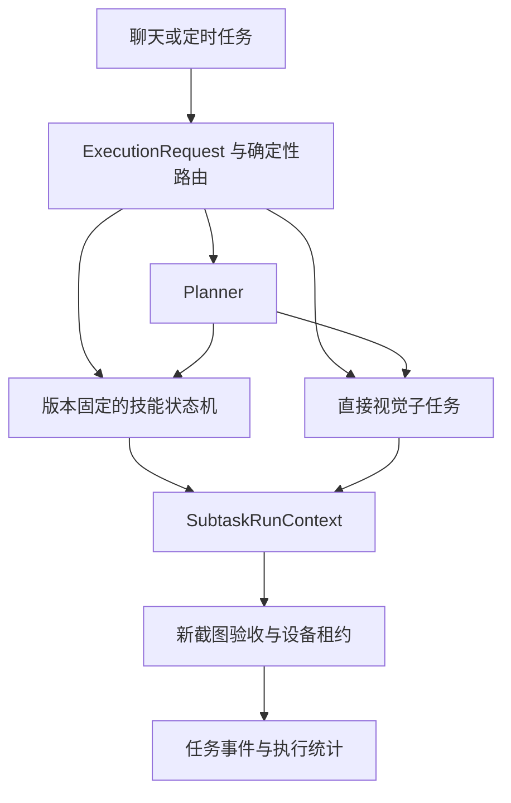

# AutoAgent-GUI 运行架构

## AutoMobile 界面与 USB 设备发现

网页侧栏、欢迎页和浏览器标题使用 AutoMobile，导航 Logo 与网页图标采用同一套
手机触控图形。Python 包、CLI、模型名称和历史数据路径保持兼容。

USB 设备由运行后端的电脑通过 ADB 自动发现，经 `/api/devices` 进入共享的
`DeviceProvider`，可见页面每 3 秒刷新。侧栏提供“刷新设备”按钮，立即重新读取
设备列表；它复用现有轮询缓存，不重启 ADB 或变更手机配置。“添加设备”说明 USB
自动识别流程，“无线连接”仍只扫描 mDNS 无线设备并支持 IP/端口与模拟器连接。

设备列表属于当前页面连接的后端实例。使用 `ADB_SERVER_SOCKET` 隔离 ADB 的测试
实例不能用于 USB 真机连接；排障时应核对浏览器端口与该实例的 `/api/devices`，
不能把另一端口的设备列表当成当前页面已识别设备的证据。正常使用应打开连接真实
ADB 的本地服务；保留验收实例的隔离设置，避免测试意外访问真机。

本次界面变更无数据迁移；回滚前端构建即可恢复原名称、图标和连接说明。

## RMQ1 iPhone 连接

新增 `connection_type=rmq1`、`platform=ios`，在设备列表中与 USB、WiFi、
HTTP Remote 并存。`DeviceManager` 只在登录、手机配置、HID 和首张画面检查通过后
注册连接；ADB 轮询不移除 RMQ1，列表状态来自视频新鲜度。删除连接及服务停止时
关闭视频线程并清除内存凭据。当前 RMQ1 页面沿用设备列表、AI 对话区、手机画面的布局；`Rmq1ChatPanel`
仅呈现明确禁用的对话入口，不挂载 Android 的任务会话或调用模型。右侧
`Rmq1Panel` 支持预览与有界手动操作，
`DeviceProtocol` 的 AI 初始化和旧 ADB 控制、scrcpy 入口显式拒绝 RMQ1。

浏览器通过 `/api/rmq1/{probe,connect,disconnect,observe,gesture,recover}` 与后端交互。
连接握手先校验 USB 与鼠标配置，再建立持久控制通道；首次 HID 状态可短暂离线，
最多等待 5 秒确认在线后才启动视频和注册设备。此等待只用于启动，操作与心跳仍严格
校验在线、模式及连接状态。控制会话初始化会由固件释放 HID，不发送试探点击或移动，
也不清除历史未确认标记。
`observe` 附带同一帧几何对应的 `content_rect`（归一化采集画面坐标，包含
`x/y/width/height`）。前端默认裁去黑边，缩放完整原图后在此区域内显示；手动
操作仍提交原始采集画面的归一化坐标，后端继续校验帧、会话、几何与黑边。
旧服务未返回有效区域时显示完整画面；显示设置可切换完整画面和调整栏宽。
缩放窗口或切换显示设置会取消尚未提交的手势。窄内容区改为上下排列并可滚动。
未来 AI 接入仍需独立实现 iPhone 执行能力与授权，不因界面统一而启用 Android 路径。
`RMQ1Transport` 只访问私有 IPv4 的 443 端口，在每次 TLS 连接发送密码或 cookie
前核对叶证书 SHA-256，不跟随重定向。密码、cookie 不持久化。
`RMQ1Device` 先建立持续的 `/api/ws` 会话启动按需推流，再从 `/api/media/ws`
接收 H.264，使用 PyAV 解码，在内存保存最新 PNG；手势复用同一控制通道，
空闲心跳与手势通过互斥锁串行读取状态和确认消息；
前端单请求轮询，仅活动页面更新，按下到松开期间固定观察帧。

手势绑定 session/frame/action ID，串行执行，在发送前校验 3 秒时效、尺寸、
方向和 HID 绝对定位输出（`usb`、`usb_hybrid`）。连接绑定首次确认的输出模式，
中途切换即停止输入。混合模式的绝对定位与按钮走不同 USB 端点，定位后至少等待
80 毫秒，并重新核对画面时效、尺寸、几何和 HID 状态后才按下；失败保留待确认标记。
坐标剔除黑边后按手机方向映射到 HID；释放后等待
原控制通道 pong，回执范围仅为 `kvm_transport`。操作 ID 去重与结果保留在
会话内，写入前持久化 0600 待确认标记以跨重启阻止未知动作重放。恢复必须由
使用者核对手机并显式确认；不自动重连或切换输入通道。AI 入口不可用，因此
这条路径由 RMQ1 自身的操作锁管理，不参与 Android 的流式触摸会话。

配置、使用限制、故障恢复及物理验收要求见 [RMQ1 iPhone 接入](rmq1-iphone.md)。

后端是 `AutoGLM_GUI/` 中的 Python/FastAPI 服务，HTTP API 与 Socket.IO 由 `server.py` 合并为 ASGI 应用；React 前端在 `frontend/`，桌面打包在 `electron/`。AI Agent 通过设备适配器执行任务；手动控制与任务共用 `PhoneAgentManager` 的设备占用边界。

## 应用布局与设备列表

应用不再显示全局横向底栏。语言、主题、构建版本、更新与版本不匹配提示集中在左侧导航的“界面设置”弹层，保留原有版本查询逻辑。设备分组列表采用名称/连接类型主行、序列号/操作次行；状态点附在设备图标上，移动分组入口不再占用额外侧列。长名称最多展示两行，并通过悬停显示完整名称。设备选择与重命名、移动分组、无线连接操作分别处理事件，操作按钮不会触发设备选择。手机面板自己的状态栏保持独立。

## 统一聊天入口与兼容边界

聊天页 `/chat` 默认使用任务路由入口 `execution.py`，在现有 `layered` 会话中选择技能、直接视觉执行或 Planner。三条路径共用 `subtasks.py` 的任务租约、结构化结果与新截图验收。Planner 会话仍由 SQLiteSession 管理，手机执行器按 task 隔离。高级设置中的经典模式仍由 `TaskManager._execute_classic_chat` 执行，保留图片输入及原有接管路径；它与第二版的已验证直接执行不同。

分层执行在视觉适配器自身的系统提示词后追加目标确认、坐标单位、误点即停止
和禁止盲目重放等约束。Gemini 保留 function calling 协议，GLM/Qwen 保留各自
动作格式；重置时重新读取当前提示词配置。分层子任务采用下面定义的动态步数预算，
同子任务续跑保留上下文，任务结束销毁局部执行器。预算包含模型的完成报告轮次。
`ELEMENT_NOT_FOUND`、`WRONG_TARGET`、`SCREEN_CHANGED` 等明确失败不能被普通
finish 报告或后续 Planner 文字改判成功。

独立的 MCP `chat` 保留每次 5 步、重置及恢复原配置的兼容行为，也追加保留原协议的
约束；它没有分层 `execute_subtask` 的 checkpoint 或独立完成验收。Planner 只暴露 `list_devices / list_skills / execute_skill / execute_subtask`；独立 MCP 接口不参与技能路由。

顶部不再提供双模式切换。设备栏「设置 → 高级设置 → 聊天执行方式」保留「自动规划（默认）」和「直接执行」，保存后应用，取消或关闭放弃未保存的选择。选择仅记录在当前聊天 URL；刷新沿用，新的无模式链接仍默认自动规划。路由以 URL 为模式来源，继续识别旧 `mode=classic` 和 `mode=chatkit`，不迁移或删除旧会话及历史。

Planner 路径需要视觉模型和决策模型；技能与已验证直接执行只需要视觉模型。缺少决策模型时仍展示技能和直接执行入口，直接执行必须填写明确完成条件。API Key 是否必需由所用服务决定。

视觉模型与决策模型页签均提供 `DeepSeek V4.1 Flash` 预设，填入官方 OpenAI 兼容地址 `https://api.deepseek.com` 与模型 ID `deepseek-flash`。视觉预设同时选择 `General Vision Agent`（`agent_type=gemini`）并清空其他 Agent 的专用参数，复用现有图片输入与 function calling 路径；切回智谱或 ModelScope 的 AutoGLM 视觉预设时恢复 `glm-async` 及其默认参数，避免沿用不匹配的工具调用协议。决策预设只修改决策地址和模型名称。两个 API Key 输入框由用户分别配置，预设不提供密钥。选择后仍需保存，取消或关闭会恢复原配置，不改变未选择预设的现有配置与默认值。官方接口与图片输入说明见 [API 文档](https://api-docs.deepseek.com/) 和 [Vision 指南](https://api-docs.deepseek.com/guides/vision/)。`deepseek-flash` 的视觉与规划请求均显式关闭 DeepSeek 思考模式：视觉端保持强制工具调用（思考模式不支持 `tool_choice=required`），规划端避免现有 Chat Completions 会话丢失 `reasoning_content` 导致多轮工具调用失败。其他模型沿用原有行为。本次不增加公共 API 或数据库迁移；回滚前端即可移除预设，已保存配置仍可作为自定义服务使用。真实 DeepSeek 调用与真机执行需在用户配置密钥后另行验证。

后端会话与 MCP 的 `mode` 仍使用既有 classic/layered 值；任务内的 `execution.route` 独立选择路径。定时任务已改为绑定技能 ID、版本、参数，不再使用 workflow 或 execution_mode。配置服务请求失败不会自动切换执行方式。

聊天入口的布局调整不改变手机控制协议。浏览器回归验证默认分层会话、保存/取消、刷新恢复、旧链接、缺少决策模型的提示与直接执行入口；原有直接执行任务、图片输入及接管恢复测试继续运行。回滚前端版本可恢复顶部切换，不需数据库迁移。上述测试不代表两个模式的真机成功率或性能对比。

## 已验证子任务与执行器范围

当前内置执行器只保留 GLM（`glm-async`，兼容 `async-glm`，原始 `glm` 配置自动规范化）、Qwen（`qwen`）和
General Vision（`gemini`，兼容 `general-vision`）。MAI、DroidRun、Midscene 的代码、专用参数 UI、依赖和打包入口移除。旧配置仍按原类型读取，`GET /api/config` 返回新增的 `agent_type_supported=false`，不会回退默认执行器；保存和初始化拒绝旧类型。用户改选受支持类型后清空旧 `agent_config_params`，历史中的旧类型标签与字符串结果仍能读取。配置保存和删除先在 manager 建立原子更新边界：已有任务、租约或人工操作时返回 409 且不写盘；更新期间拒绝新的设备获取。保存、环境同步及空闲执行器销毁完成后解除更新边界；删除保留原有语义，不额外同步环境或重建执行器。

`execute_subtask(device_id, goal, success_criteria, constraints, max_steps=10, checkpoint=None)`
按可验证的界面状态划分子目标，每段预算为 1–20 步，整个 task 的累计步数受请求预算和
`default_max_steps` 的较小值约束，Planner 轮数仍受 `layered_max_turns` 约束。返回七种状态：
`completed / partial / blocked / failed / cancelled / needs_user / unknown`。
兼容包保留 `result / steps / success`，result 增加目标、状态、停止原因、累计步数、验收摘要与续跑句柄；success 仅 completed 为真。进度事件区分 executing 与 verifying。

模型 `finish` 只申请完成。系统继续持有设备并取得新截图，复用执行器视觉模型进行只读、无动作工具的验收；逐项返回 `met / unmet / unknown` 及理由、可观察事实、时间和截图 SHA-256。
所有条件满足才能 completed；明确未满足返回 partial，验收不可用或不可判定则停止。
这张验收截图只在内存参与判断，不加入工具结果或历史，也不新增图片读取 API；
hash 不能用于回看图片。下述执行阶段的回放截图沿用原有 trace 采集策略，与这张独立验收截图分开处理。

验收请求固定使用 `max_tokens=4096`，为模型推理和最终 JSON 共同预留输出预算；
总超时为 130 秒，模型请求超时为 120 秒，SDK `max_retries=0`。
系统先检查响应是否完整，再解析 JSON 和核对条件。`finish_reason=length` 返回
`verification_output_truncated`，即使截断响应恰好能解析也不能通过；其他非 `stop`
结束原因、空响应、JSON/结构错误、条件不匹配、请求失败和超时均有独立错误分类，
返回 `blocked`。不因此自动重试验收或重放设备操作。

`subtask.verify` span 覆盖截图、模型调用、解析与条件匹配，模型调用仍为其子 span。
验收结果新增可选 `diagnostics`，只记录固定字段的诊断元数据：阶段、预算、结束原因、
token 用量、响应长度与 SHA-256、请求 ID 的 SHA-256、异常类型、脱敏校验路径和条件不匹配索引。
不保存原始响应、思维链、验收截图、密钥或服务方错误原文；旧记录没有该字段仍可读取。
字段随现有任务事件和历史保存，无数据库迁移。详见[追踪与可观测性](docs/explanation/observability.md)。

partial 仅用于本段预算耗尽或验收明确未满足，附当前 task 内的一次性 checkpoint。
续跑校验目标、条件、约束及设备一致，保留执行器上下文并注入验收差异；旧句柄消费后失效。
未完成子任务须先续跑，不能跳过后新建子任务。checkpoint 不跨用户轮次、task 或进程恢复；取消、结束、模型配置变化后不可复用。整体成功要求至少一个子任务，且所有已发起子任务的最新状态均 completed；其他终止状态不能被 Planner 最终文字覆盖。第二版任务入口在 Planner 正常结束后，额外对用户原始目标或明确传入的最终条件进行只读验收；未能从当前截图证明的要求保持未验证，不能由 Planner 自述补足。

当前 task 的 SDK run context 另保留按设备隔离、有界的近期执行摘要，用于后续子目标
了解已有操作。摘要包含目标、结果与动作几何，不复制图片、完整模型推理或输入文本
参数；同一子任务的续跑由原执行上下文及验收差异支持。摘要和旧坐标只作为历史数据，
执行器必须重新观察当前画面，不能自动重放。它们不跨 task 或后端重启恢复，
也不改变 Planner 会话的持久化方式。

设备租约在 task 首次使用设备时取得，贯穿执行、验收与 partial 等待；同物理设备的其他 Agent context 与人工输入不能写入。取消只命中所属 task，先停止新动作，等待在途本地 ADB / 远端操作结算后释放租约；无法确认则保留设备隔离，不重放未知动作。task 结束销毁局部执行器、清理 checkpoint，Planner 对话与历史继续保留。

分层内部执行回放继续写入 `logs/runs/<trace_id>/replay.jsonl` 的 `phone_agent`
事件，以独立 `call_id` 关联每段执行及其步骤 `index`；`event_seq` 在每段内编号。
Gemini 通用 function calling 适配器记录模型实际看到的 `observation`、模型选定
动作、`pre_action` 和 `post_action` 截图及执行结果，保存图像宽高。推理期间尺寸
改变会停止而不点击。其他适配器记录流式步骤结果，不宣称已有同等截图覆盖。
后续截图失败不会重放已执行的操作；取消时保留已取得的证据。执行截图只证明采集
时的画面，操作返回成功也不等于目标通过验收；尺寸检查不排除同尺寸的 UI 变化。

回放复用 `AUTOGLM_TRACE_ENABLED`、`AUTOGLM_TRACE_REPLAY_ENABLED`、
`AUTOGLM_TRACE_CAPTURE_SCREENSHOT=artifact|off|on_error` 和
`AUTOGLM_TRACE_CAPTURE_ACTION`。默认 `artifact`；`on_error` 在该段未完成或取消时
保留其截图缓冲，最多 60 帧（20 步、每步最多 3 帧），超出时保留最新证据，
不会在结果确定前直接落盘；敏感截图不保存。文件名包含调用 ID，避免不同子任务或续跑段
互相覆盖；图片以 artifact 引用保存在回放文件，不把 base64 写入模型返回文本或
任务数据库。沿用历史删除/回放删除机制，旧回放事件格式保持兼容。回归使用模拟
设备，真实模型的目标定位准确率和执行效果仍需单独验收。

本版不增加技能库、UI tree/OCR 路由或持久化动作账本。无需数据库结构迁移，状态与验收摘要随现有任务事件保存。升级/回滚须先停止任务并核对设备空闲，成套更新前后端；进程内 checkpoint 会失效。回滚到旧版本才能重新使用被移除的执行器，清空的旧参数需从升级前保存的配置恢复。确定性回归覆盖状态、验收、续跑、互斥与取消边界，真实成功率、误报率、token 与耗时改进仍需真机对照实验。

## Android 预览与手动控制

```text
Android scrcpy 3.3.3 视频 socket → Python 分包 → Socket.IO → WebCodecs → Canvas
Pointer Events → 前端有序队列 → control-input → ControlSession → scrcpy 控制 socket
```

`scrcpy_stream.py` 启动工程携带的 3.3.3 服务端。新控制会话使用随机 `scid` 和 ADB 动态转发端口，各自关闭自己的连接和进程，不清理其他 scrcpy 实例。视频、控制各用一个 socket；音频和剪贴板自动同步关闭。控制协议固定为 3.3.3，升级服务端时必须同时核对二进制布局和回归测试。当前支持一个触摸指针及原生滚轮，不提供多指手势。

默认标准档为最长边 1280、4 Mbps、20 FPS；流畅档为 1280、4 Mbps、30 FPS；低带宽档为 800、1 Mbps、15 FPS。档位保存在浏览器本地，改变档位会结束旧连接并重新建立视频会话。以上是编码上限，不能视为实测帧率或延迟。

## 输入顺序与坐标

`frontend/src/lib/phone-control.ts` 保持一个发送中的命令，并合并相邻未发送的 MOVE。DOWN、UP、CANCEL 不会因节流被丢弃，队列最多 32 项。坐标来自当前已渲染视频尺寸，限制到 `[0, width-1] × [0, height-1]`，由 scrcpy 将视频坐标映射到设备显示，不依赖首次截图尺寸。

后端每个控制会话使用独立 ID、单调序号和互斥锁；视频配置包使 epoch 增加。旧会话、乱序输入、旧 epoch 和越界坐标被拒绝。新尺寸完成渲染后取消旧手势；未获得新几何信息时不能假定释放成功。

Pointer capture 保证拖出画面仍收到松开。失焦、pointercancel、捕获丢失及页面隐藏请求取消。触摸期间断线时，后端先写入 scrcpy CANCEL，再通过设备原生 `input motionevent CANCEL` 等待取消处理，最后关闭投屏进程并释放设备所有权，避免取消数据尚未注入就终止服务器。原生取消最多等待 5 秒；失败、超时或旧 Android 不支持 CANCEL 时保留隔离，需检查手机后显式恢复。命令完成不等同于业务成功，真机测试仍用受控应用的触摸计数核对。触摸期间浏览器每 750ms 发心跳，后端超过 2.5 秒无活动尝试取消。写入超时 1.5 秒，浏览器控制 ACK 超时 3 秒。失败不会自动重放 DOWN、MOVE 或 UP。

## 所有权、失败与人工恢复

手势期间持有设备所有权；AI 的任何 context 为 BUSY 时拒绝人工输入，人工手势期间拒绝 AI 获取设备。人工操作前应先停止正在执行的 AI 任务。视频观看本身不占用 AI 执行权。

控制 ACK 的 `sent` 只代表数据写入控制 socket；scrcpy 没有逐触摸的 Android 注入确认，不能声称业务动作成功。界面取消原来的“已点击/已滑动”乐观提示。控制失败或无法确认释放时，后端保留设备隔离，重新连接不会自动解除。操作者检查手机已无未结束触摸后，使用“确认手机状态并恢复”明确解除。该隔离位于当前后端进程内，不是持久化执行账本；进程异常退出后必须人工检查手机状态再操作。

旧 `/api/control/*` 接口保留响应结构。tap/swipe 与新控制、AI 共用占用边界；HTTP 请求取消后仍等待底层 ADB 线程结束才释放占用，执行失败则保留隔离；HTTP DOWN/MOVE/UP 按设备串行并检查 ADB 退出码。HTTP touch 要求明确 device_id；没有 DOWN 的 MOVE 被拒绝，UP 可单独请求释放；HTTP 触摸闲置 15 秒尝试释放，失败保留隔离。旧 HTTP 客户端不支持流会话的 epoch 校验，浏览器使用新协议。

## 视频与可观测性

新客户端逐包 ACK：配置包在解码器接收配置后确认，数据包在帧渲染后确认。后端等待 ACK 再读下一包，3 秒未确认则关闭该流，限制应用层和浏览器队列积压。设备编码器/ADB/TCP 内部仍可能缓存，不能把这个上限等同于端到端延迟上限。

界面显示当前使用视频还是截图，以及渲染 FPS、最近最多 100 个控制请求的往返 P95。P95 使用浏览器单调时钟；后端响应包含本地处理耗时 `server_ms`。它们都不代表手指到屏幕响应的端到端测量。画面超过 3 秒未更新会提示，并限制新输入，避免盲点操作。

手机面板采用页头、画面、页脚的纵向布局：页头常驻“显示设置”，展开后在画面上方调整模式、画质和面板宽度；页脚显示当前模式、渲染 FPS 和控制 P95。设置、状态和错误/恢复提示均参与布局，不叠加到视频或截图上。画面按原始比例完整缩放，设置展开和横屏时也不裁切。截图模式只显示“仅查看”，不保留视频的旧指标。播放器通过 `onPlaybackStats` 向面板报告状态与指标，此接口不改变视频和输入协议。

H.264 播放器通过 `connect-device.videoWindow=4` 协商最多 4 个未完成渲染的帧，让 USB 读取、解码与绘制并行，避免每帧都等待一次完整往返才读取下一帧。后端由单一生产者顺序发送二进制事件，按发送时刻限制每帧渲染确认的 3 秒期限；发现配置变化即推进输入 epoch，拒绝旧几何输入；等待旧帧全部完成后再传递新配置。前端使用带唯一时间戳的原生 H.264 解码器，将每个输出帧绑定到对应的几何与 ACK，实际绘制完成才确认；释放解码器后不确认迟到帧。窗口溢出或解码错误终止连接，不建立无界队列。旧前端、旧后端以及非 H.264 解码路径保留单帧确认兼容；输入顺序、所有权、未知结果隔离和取消机制不变。

自动模式在首次连接超时或不支持 WebCodecs 时回退截图；已建立连接出错后显示重连/恢复入口；截图模式每次请求结束后等待 750ms，自动回退等待 1200ms。截图请求在 15 秒后取消并展示超时错误；业务失败与 HTTP/网络错误也进入错误提示，不再停留在加载中。失败后继续按上述间隔轮询，设备恢复后自动显示新画面。切换设备、模式或页面不可见时取消在途请求，旧设备的画面与迟到响应不会显示到新设备。截图分支只读。视频必须具备 WebCodecs 支持和安全上下文。

## 验证与上线/回滚

单元和契约测试覆盖 scrcpy 二进制、手势顺序、释放、过期/错误会话、未知结果隔离、AI 互斥、旧 HTTP 行为以及启动/断线竞态。浏览器测试用合成 H.264 经真实 WebCodecs 解码，并验证拖出画面释放、失焦取消和队列不重放；它不证明真机注入已完成。

本地完整 E2E 验证可设置 `AUTOGLM_E2E_SCREENSHOTS_DIR=test-results/docs-screenshots`，将文档截图产物写入前端测试目录，避免覆盖已跟踪文档图片；未设置时保留原文档截图生成路径。

前后端应成套更新，旧后端缺少 session 元数据时新前端提示升级。回滚时先停止手动与 AI 操作、关闭预览、确认手机没有持续触摸，再整体回滚前后端。不得把超时后的原手势作为新动作重放。单进程后端是当前所有权和会话状态的运行前提；多进程/多主机部署需增加统一设备仲裁。

真机验收使用可控测试页面，检查连续拖动、长按、拖出窗口、失焦、旋转、断线恢复和 AI 冲突，并独立测量输入到画面响应的 P50/P95；代码测试与静态检查不能替代该验收。


## 第二版：技能、任务路由与评测

技能是版本化执行计划：参数 schema、只读前置条件、有序步骤、每步完成条件、作用类型、续跑次数、最终条件和总预算。定义存储在 `~/.config/autoglm/skills.json`，不执行 Python、shell 或坐标录制脚本。参数以 JSON 字面值替换 `{{parameter}}`，并附加“参数是数据”的固定约束；这不是对视觉模型语义遵循的形式证明。[V2E1]



自动路由只对完整的“打开微信”指令匹配内置技能，其他输入进入 Planner；明确选择技能时要求 ID、版本和通过校验的参数，直接模式要求非空完成条件。Planner 可发现技能并执行固定版本。技能前置条件只读检查，步骤完成才推进游标，所有步骤完成后重新检查技能整体条件。计划不能在运行中改成新版本；更新保留历史版本，禁用使旧版本也不能新开任务；删除保留 ID 墓碑，防止同 ID/v1 重建后悄悄改变已有定时任务。[V2E1][V2E2]

默认总预算为 60 步/300 秒，取请求、配置及技能预算的较小限制。每步最多 20 步，最多 3 次续跑；导航/读取步骤只有 `partial` 且有效 checkpoint 才可自动续跑。首次允许一个有界续跑段，后续必须有更多完成条件被证实；截图发生变化不算进展。`write` 步骤默认且强制不自动续跑。终止失败、歧义、接管、未知设备结果直接停止；超时取消执行并结算在途效果，无法确认仍为 unknown。[V2E2]

`TaskStore.create_task_run` 在同一 SQLite 事务内保存任务和包含 execution 的 user_message，再让队列看见任务；事务失败回滚，不允许执行参数尚未落盘的技能。`execution_route / skill_progress / execution_continuation / execution_summary` 沿现有任务事件落库，摘要同时进入历史详情。模型请求在实际调用点统计，提供方缺失 usage 时保留 null；步骤数不充当模型调用数。评测工具比较相同 case/repetition 的数据，真实完成率与误报率需要独立人工标签，合成 fixture 不产生真实节省结论。[V2E3][V2E4]

当前实现使用截图与视觉验收，不包含 UI tree/OCR 混合感知、任意分支图、自动生成并发布技能、跨任务 checkpoint 恢复或通用弹窗自动处理。内置微信导航技能是可编辑副本的起点，仍需在目标设备和应用版本上做业务验收。没有真机数据时不能宣称调用量、耗时或成功率已改善。

自动化回归中的后端使用独立临时存储及 `spawn` 子进程，避免并行 worktree 相互覆盖模型配置、技能和任务记录。浏览器端默认端口为 3000，可用 `AUTOGLM_E2E_PORT` 指定其他端口；端口占用直接失败，不自动连接其他测试服务。

### 升级与回滚

前后端一起更新。`/api/workflows`、旧工作流页面与纯文本执行实现已移除；`workflows.json` 保留但不读取。旧定时任务保留可见记录并标为失效/禁用，须重新选择技能和参数才能执行；首次改写定时文件前保留 `scheduled_tasks.legacy.json`。旧 SQLite 历史列保留为数据档案，不再参与调度。技能 API 支持带 expected_version 的编辑/删除，冲突返回 409，损坏的目录返回 503，不覆盖坏文件。[V2E1][V2E5]

回滚前停止任务、确认设备空闲，整体回滚前后端。技能配置保留供以后恢复，旧版不识别；只有用户确认后才用 legacy 备份恢复旧定时配置，避免回滚后意外重新启用原任务。生产配置与真机状态不由代码测试自动迁移。

使用说明见[技能库](docs/guide/use-skills.md)，评测导出与运行命令见[执行评测](docs/explanation/execution-evaluation.md)。

| ID | Locator | Observation | Confidence |
| --- | --- | --- | --- |
| V2E1 | `AutoGLM_GUI/skills.py#SkillManager` | 参数编译、版本存储、原子写入与删除墓碑 | High |
| V2E2 | `AutoGLM_GUI/execution.py#execute_skill` | 路由、按步骤验收、续跑预算与任务终态 | High |
| V2E3 | `AutoGLM_GUI/task_store.py#create_task_run` | 任务及请求在同一事务内可见，失败回滚 | High |
| V2E4 | `AutoGLM_GUI/evaluation.py` | 人工标签、匹配比较与未知成本语义 | High |
| V2E5 | `AutoGLM_GUI/scheduler_manager.py` | 技能调度和旧定时任务禁用 | High |
