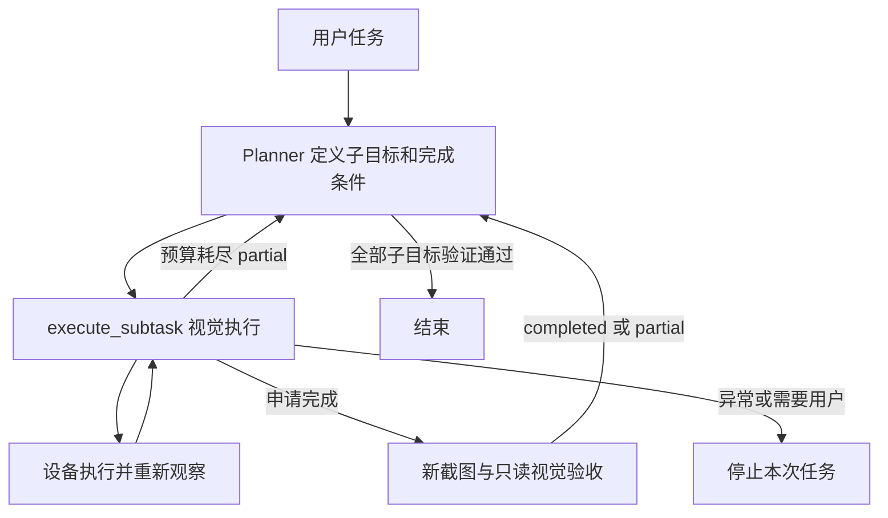

# 分层代理架构

默认聊天采用「目标规划 → 有状态执行 → 新截图验收」的流程。Planner 负责定义子目标和完成条件，视觉执行器独立完成局部操作，在完成、预算耗尽或受阻时返回结构化状态。

## 子任务与续跑

Planner 通过 `execute_subtask` 传入设备、目标、非空完成条件列表、约束及本段步数预算。例如：「找到联系人张三，打开聊天页；完成条件是页头姓名为张三；重名时停止，不输入或发送消息」。点击、搜索和观察由执行器完成。

每段默认 10 步，可请求 1–20 步。总步数沿用 `default_max_steps`，跨子任务和续跑累计；规划轮数仍受 `layered_max_turns` 限制。达到本段预算或新截图明确显示条件未满足时返回 `partial`，并附一次性 checkpoint。Planner 使用相同目标、条件、约束和设备续跑，保留执行器上下文和已完成进度。

checkpoint 仅当前 task、当前后端进程内有效。不能跨用户轮次、task、设备或重启复用；模型配置变化、任务取消或结束使其失效。未完成子任务应先续跑，不能新建任务绕过已有部分进度。

## 完成判断

执行器输出 `finish` 仅表示申请完成。系统在仍占有设备时重新截图，复用当前视觉模型进行一次不带动作工具的验收，按顺序检查每项完成条件：`met`、`unmet` 或 `unknown`。

只有所有条件为 `met` 才返回 `completed`。明确未满足为可续跑的 `partial`；截图不可用、验收调用失败、格式错误或无法判断均停止，不能把执行器的自述当成证据。截图只在内存参与验收，历史保存判断、事实、时间及截图 SHA-256；摘要不能替代可回看的原图。

状态包括 `completed / partial / blocked / failed / cancelled / needs_user / unknown`。最后五类停止当前 task；需要用户操作时，应处理后发起新任务。没有已验证子任务、仍有 partial 或任何终止失败时，Planner 自然结束或声称成功都不会把整体任务记为成功。

## 设备与使用边界

同一物理设备在执行、验收和 partial 等待期间只由该 task 控制，直接执行、其他会话和人工输入不能并发写入。取消先停止后续动作，等待已发出的设备调用结束；无法确认的动作保留设备隔离，不能自动重放。

当前支持 GLM、Qwen 和 General Vision 三类执行器。视觉模型承担局部执行及验收，决策模型负责规划，两组配置仍然独立。验收增加子任务结束时的一次模型调用；本版不新增技能库、UI tree/OCR 路由或跨 task 恢复，可靠性与耗时收益须经同任务对照测试确认。

实现契约与兼容边界见[深入分析](./layered-agent-analysis.md)，类型迁移见[Agent 类型说明](./agent-types.md)。
